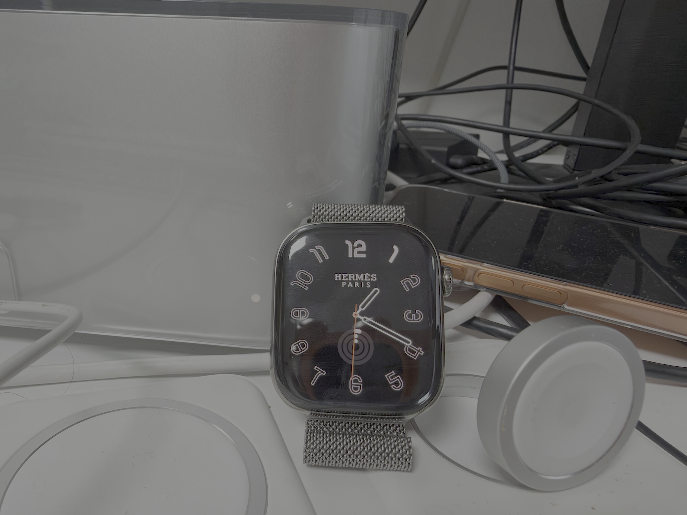

# HermesEnabler 2

[English](README.md) · [Tiếng Việt](README.vi.md) · [한국어](README.ko.md) · [简体中文](README.zh-CN.md) · [繁體中文](README.zh-TW.md) · [日本語](README.ja.md) · [Español](README.es.md) · [Français](README.fr.md) · [Deutsch](README.de.md) · [Português](README.pt.md)



> Kompatibel mit watchOS 26.6.1 und watchOS 27.0 bis 27.3 Beta 1.

## Installation

### macOS

Unter macOS kannst du die fertige IPA mit Sideloadly installieren oder die App direkt mit Xcode erstellen. In beiden Fällen muss das iPhone mit der Ziel-Apple Watch gekoppelt sein und die Watch eine unterstützte watchOS-Version ausführen.

#### IPA installieren

1. Lade die IPA unter [Releases](https://github.com/pookjw/HermesEnabler/releases) herunter.
2. Installiere [Sideloadly](https://sideloadly.io) auf dem Mac, verbinde das iPhone per Kabel und wähle es in Sideloadly aus.
3. Ziehe die IPA in Sideloadly und gib deine Apple ID ein. Deaktiviere **Use automatic bundle ID**, lege einen festen Bundle Identifier fest und starte die Signierung.
4. Öffne auf dem iPhone **Einstellungen → Allgemein → VPN & Geräteverwaltung** und vertraue deinem Entwicklerzertifikat.
5. Öffne auf dem iPhone **Einstellungen → Datenschutz & Sicherheit → Entwicklermodus**, aktiviere ihn, starte neu und bestätige.
6. Öffne auf dem iPhone die **Watch-App**, gehe zu **Meine Watch → Apps** und installiere **HermesEnabler2** auf der Watch.
7. Öffne auf der Apple Watch **Einstellungen → Datenschutz & Sicherheit → Entwicklermodus**, aktiviere ihn, starte neu und bestätige. Wenn die Option nicht angezeigt wird, installiere zuerst die Watch-App und prüfe erneut.
8. Öffne **HermesEnabler2** auf der Apple Watch und folge den Schritten in der App.

#### Mit Xcode erstellen

1. Öffne [HermesEnabler2.xcodeproj](HermesEnabler2.xcodeproj) in Xcode.
2. Wähle die Apple Watch als Run-Ziel aus und klicke auf **Run**.
3. Öffne **HermesEnabler2** auf der Apple Watch und folge den Schritten in der App.

### Windows

Unter Windows verwendest du [WatchBridge](https://github.com/AdminZachary/iloader-for-windows), ein Community-Tool, das den Entwicklermodus vorbereitet und eine IPA installiert, die sowohl die iPhone-Host-App als auch die Watch-App enthält. Es steht weder mit Apple noch mit diesem Projekt in offizieller Verbindung.

1. Installiere **Apple Mobile Device Service**, indem du [iTunes](https://www.apple.com/itunes/) oder die **Apple Devices**-App aus dem Microsoft Store installierst. WatchBridge benötigt den Dienst für USB- und Wi-Fi-Kommunikation. WebView2 ist in Windows 11 enthalten.
2. Stelle sicher, dass dein iPhone mit der Ziel-Apple Watch gekoppelt ist. WatchBridge unterstützt jeweils nur eine gekoppelte Watch; sind mehrere gekoppelt, bricht der Vorbereitungsschritt ab, statt zu raten.
3. Lade `watchbridge-windows.zip` von [WatchBridge Releases](https://github.com/AdminZachary/iloader-for-windows/releases/latest) herunter, entpacke es und starte `WatchBridge.exe`. Die ausführbare Datei ist nicht signiert, daher kann Windows SmartScreen beim ersten Start warnen.
4. Lade die IPA unter [Releases](https://github.com/pookjw/HermesEnabler/releases) herunter. Verwende die Original-IPA, die sowohl die iPhone-Host-App als auch `Watch/*.app` enthält; reine Watch-Pakete werden nicht unterstützt.
5. Verbinde das gekoppelte iPhone per USB und wähle es in WatchBridge aus.
6. Koppele die Watch und bestätige die Vertrauensabfrage auf der Watch. Fordere den Schalter **Entwicklermodus** an, öffne dann auf der Watch **Einstellungen → Datenschutz & Sicherheit → Entwicklermodus**, aktiviere ihn, starte neu und bestätige. Kehre zu WatchBridge zurück und klicke auf **Check again**. WatchBridge aktiviert den Entwicklermodus nicht selbst und startet die Watch nicht neu.
7. Melde dich mit deiner Apple ID an, wähle die HermesEnabler2-IPA und starte Signierung und Installation. WatchBridge installiert zuerst die iPhone-Host-App und danach die Watch-App.
8. Öffne **HermesEnabler2** auf der Apple Watch und folge den Schritten in der App.

> Die Vorbereitung des Entwicklermodus erfordert eine USB-Verbindung. Nach einer einmaligen USB-Kopplung können Installation und Erneuerung über Wi-Fi erfolgen.

### Linux

WatchBridge unterstützt Linux auf x86_64 ab [v0.1.3](https://github.com/AdminZachary/WatchBridge/releases/tag/v0.1.3).

1. Lade die `.deb`-Datei für Debian/Ubuntu oder die `.rpm`-Datei für Fedora herunter. Führe im Downloadordner den passenden Befehl aus (der erste für Debian/Ubuntu, der zweite für Fedora).

   ```bash
   sudo apt install usbmuxd ./WatchBridge_0.1.3_amd64.deb
   ```
   ```bash
   sudo dnf install usbmuxd ./WatchBridge-0.1.3-1.x86_64.rpm
   ```

2. Schließe das mit der gewünschten Apple Watch gekoppelte iPhone per USB an. Starte WatchBridge (`watchbridge`) und wähle das iPhone aus. Falls es nicht erkannt wird, prüfe, ob `usbmuxd` läuft.
3. Folge den Anweisungen in WatchBridge, um den Entwicklermodus vorzubereiten. Aktiviere ihn auf der Watch, starte sie neu und bestätige die Aktivierung.
4. Lade unter [HermesEnabler Releases](https://github.com/pookjw/HermesEnabler/releases) die ursprüngliche IPA mit der iPhone-App und der eingebetteten Watch-App herunter. Melde dich in WatchBridge mit deiner Apple ID an, wähle die IPA aus und installiere sie. Öffne **HermesEnabler2** auf der Watch.

## Hinweise

- Deaktiviere in Sideloadly **Use automatic bundle ID** und verwende einen festen Bundle Identifier. Verwende bei jedem Update denselben Bundle Identifier und dieselbe Apple ID, damit vorhandene App-Daten und Backups erhalten bleiben.
- Aufgrund der **App Groups**-Berechtigung ist ein kostenpflichtiger Apple Developer Account erforderlich.
- Wird die iPhone-App installiert, aber die Watch-App nicht angezeigt, suche im Sideloadly-Protokoll nach `Watch apps will be stripped from the IPA`. Das bedeutet, dass die eingebettete Watch-App entfernt wurde; installiere sie mit Xcode.
- Stelle vor dem Löschen der App unbedingt dein MobileGestalt-Backup über die HermesEnabler2-App wieder her.

## Danksagung

Dieses Projekt enthält Code aus [Gester](https://github.com/sasobhabha/Gester).

Die Nutzung erfolgt auf eigene Gefahr.
