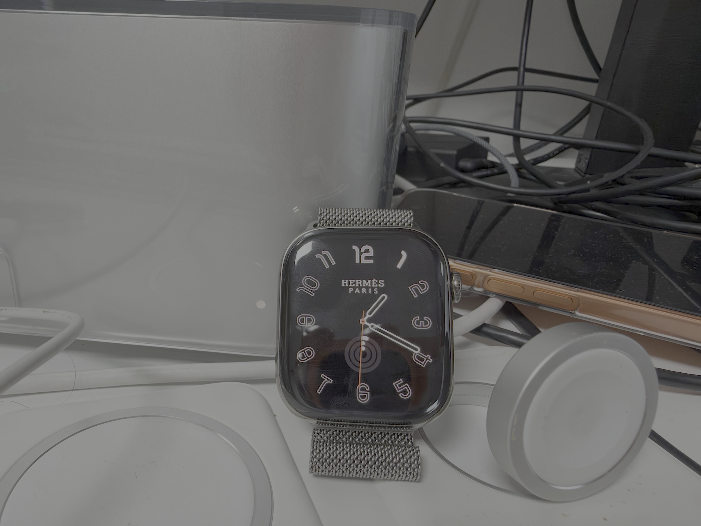

# HermesEnabler 2

[English](README.md) · [Tiếng Việt](README.vi.md) · [한국어](README.ko.md) · [简体中文](README.zh-CN.md) · [繁體中文](README.zh-TW.md) · [日本語](README.ja.md) · [Español](README.es.md) · [Français](README.fr.md) · [Deutsch](README.de.md) · [Português](README.pt.md)



> Compatible con watchOS 26.6.1 y watchOS 27.0 hasta 27.3 beta 1.

## Instalación

### macOS

En macOS puedes instalar el IPA ya compilado con Sideloadly o compilar la app directamente con Xcode. En ambos casos, el iPhone debe estar emparejado con el Apple Watch de destino y el Watch debe ejecutar una versión compatible de watchOS.

#### Instalar el IPA

1. Descarga el IPA desde [Releases](https://github.com/pookjw/HermesEnabler/releases).
2. Instala [Sideloadly](https://sideloadly.io) en el Mac, conecta el iPhone con un cable y selecciónalo en Sideloadly.
3. Arrastra el IPA a Sideloadly e introduce tu Apple ID. Desactiva **Use automatic bundle ID**, indica un Bundle Identifier fijo y comienza la firma.
4. En el iPhone, abre **Ajustes → General → VPN y gestión de dispositivos** y confía en tu certificado de desarrollador.
5. En el iPhone, abre **Ajustes → Privacidad y seguridad → Modo de desarrollador**, actívalo, reinicia y confirma.
6. En la app **Watch** del iPhone, ve a **Mi reloj → Apps** e instala **HermesEnabler2** en el Watch.
7. En el Apple Watch, abre **Ajustes → Privacidad y seguridad → Modo de desarrollador**, actívalo, reinicia y confirma. Si la opción no aparece, instala primero la app del Watch y vuelve a comprobarlo.
8. Abre **HermesEnabler2** en el Apple Watch y sigue los pasos de la app.

#### Compilar con Xcode

1. Abre [HermesEnabler2.xcodeproj](HermesEnabler2.xcodeproj) en Xcode.
2. Selecciona el Apple Watch como destino de ejecución y pulsa **Run**.
3. Abre **HermesEnabler2** en el Apple Watch y sigue los pasos de la app.

### Windows

En Windows se utiliza [WatchBridge](https://github.com/AdminZachary/iloader-for-windows), una herramienta comunitaria que prepara el modo de desarrollador e instala un IPA que contiene tanto la app anfitriona del iPhone como la app del Watch. No está afiliada a Apple ni a este proyecto.

1. Instala **Apple Mobile Device Service** instalando [iTunes](https://www.apple.com/itunes/) o la app **Apple Devices** de Microsoft Store. WatchBridge lo necesita para la comunicación por USB y Wi-Fi. WebView2 viene incluido en Windows 11.
2. Comprueba que el iPhone esté emparejado con el Apple Watch de destino. WatchBridge admite un solo Watch emparejado a la vez; si hay más de uno, el paso de preparación se detiene en lugar de adivinar.
3. Descarga `watchbridge-windows.zip` desde [WatchBridge Releases](https://github.com/AdminZachary/iloader-for-windows/releases/latest), extráelo y ejecuta `WatchBridge.exe`. El ejecutable no está firmado, por lo que Windows SmartScreen puede avisar en el primer inicio.
4. Descarga el IPA desde [Releases](https://github.com/pookjw/HermesEnabler/releases). Usa el IPA original que contiene tanto la app anfitriona del iPhone como `Watch/*.app`; los paquetes solo para Watch no son compatibles.
5. Conecta el iPhone emparejado por USB y selecciónalo en WatchBridge.
6. Empareja el Watch y confirma el aviso de confianza en el Watch. Solicita el interruptor de **Modo de desarrollador**; después, en el Watch, abre **Ajustes → Privacidad y seguridad → Modo de desarrollador**, actívalo, reinicia y confirma. Vuelve a WatchBridge y pulsa **Check again**. WatchBridge no activa el modo de desarrollador ni reinicia el Watch por ti.
7. Inicia sesión con tu Apple ID, selecciona el IPA de HermesEnabler2 y comienza la firma e instalación. WatchBridge instala primero la app anfitriona del iPhone y después la app del Watch.
8. Abre **HermesEnabler2** en el Apple Watch y sigue los pasos de la app.

> La preparación del modo de desarrollador requiere conexión USB. Después de emparejar una vez por USB, las instalaciones y renovaciones pueden usar Wi-Fi.

### Linux

WatchBridge es compatible con Linux en x86_64 desde la versión [v0.1.3](https://github.com/AdminZachary/WatchBridge/releases/tag/v0.1.3).

1. Descarga el paquete `.deb` para Debian/Ubuntu o el `.rpm` para Fedora. Ejecuta el comando correspondiente en la carpeta de descargas (el primero para Debian/Ubuntu, el segundo para Fedora).

   ```bash
   sudo apt install usbmuxd ./WatchBridge_0.1.3_amd64.deb
   ```
   ```bash
   sudo dnf install usbmuxd ./WatchBridge-0.1.3-1.x86_64.rpm
   ```

2. Conecta por USB el iPhone que ya está emparejado con el Apple Watch de destino, abre WatchBridge (`watchbridge`) y selecciona el iPhone. Si no aparece, comprueba que `usbmuxd` esté en ejecución.
3. Sigue las indicaciones de WatchBridge para preparar el modo de desarrollador. Actívalo en el reloj, reinicia el reloj y confirma.
4. Descarga desde [HermesEnabler Releases](https://github.com/pookjw/HermesEnabler/releases) el IPA original que incluye la app para iPhone y la app integrada para el Watch. Inicia sesión con tu Apple ID en WatchBridge, selecciona el IPA e instálalo. Abre **HermesEnabler2** en el reloj.

## Precauciones

- En Sideloadly, desactiva **Use automatic bundle ID** y utiliza un Bundle Identifier fijo. Usa el mismo Bundle Identifier y Apple ID en cada actualización para conservar los datos y la copia de seguridad existentes.
- Se requiere una cuenta de Apple Developer de pago debido a la capacidad **App Groups**.
- Si se instala la app del iPhone pero no aparece la del Watch, busca `Watch apps will be stripped from the IPA` en el registro de Sideloadly. Significa que se eliminó la app Watch incluida; instala la app Watch con Xcode.
- Antes de eliminar la app, restaura siempre la copia de seguridad de MobileGestalt desde la app HermesEnabler2.

## Créditos

Este proyecto incorpora código de [Gester](https://github.com/sasobhabha/Gester).

Úsalo bajo tu propia responsabilidad.
