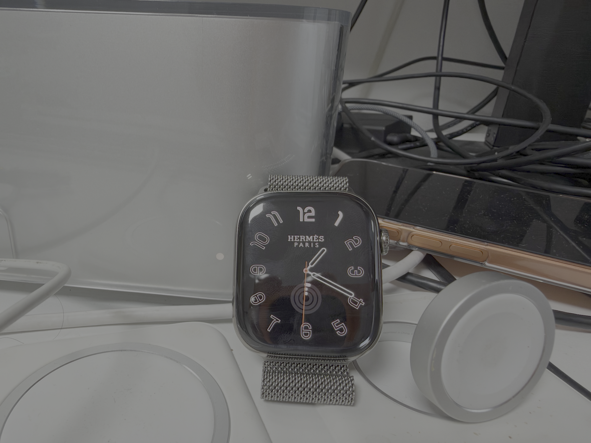

# HermesEnabler 2

[English](README.md) · [Tiếng Việt](README.vi.md) · [한국어](README.ko.md) · [简体中文](README.zh-CN.md) · [繁體中文](README.zh-TW.md) · [日本語](README.ja.md) · [Español](README.es.md) · [Français](README.fr.md) · [Deutsch](README.de.md) · [Português](README.pt.md)

> 仅支持 watchOS 27.0 至 27.3 beta 1。

## 安装

### macOS

在 macOS 上，你可以用 Sideloadly 安装预构建的 IPA，也可以直接用 Xcode 构建应用。两种方式都要求 iPhone 已与目标 Apple Watch 配对，且手表运行受支持的 watchOS 版本。

#### 安装 IPA

> **Sideloadly 0.72 已知问题：** [问题 #43](https://github.com/pookjw/HermesEnabler/issues/43) 报告称，该版本可能在签名时移除 IPA 内嵌的 Watch App。如果 iPhone App 已安装，但 Watch 上没有 HermesEnabler2，请改用 Xcode。此报告针对 0.72 版本，其他版本的兼容性尚未确认。

1. 从 [Releases](https://github.com/pookjw/HermesEnabler/releases) 下载 IPA。
2. 在 Mac 上安装 [Sideloadly](https://sideloadly.io)，用数据线连接 iPhone，并在 Sideloadly 中选择该设备。
3. 将 IPA 拖入 Sideloadly 并输入 Apple ID。关闭 **Use automatic bundle ID**，指定固定的 Bundle Identifier，然后开始签名。
4. 在 iPhone 上打开 **设置 → 通用 → VPN 与设备管理**，信任你的开发者证书。
5. 在 iPhone 上打开 **设置 → 隐私与安全性 → 开发者模式**，开启、重启并确认。
6. 在 iPhone 的 **Watch App → 我的手表 → App** 中，将 **HermesEnabler2** 安装到手表。
7. 在 Apple Watch 上打开 **设置 → 隐私与安全性 → 开发者模式**，开启、重启并确认。如果没有显示该选项，请先安装手表 App，然后再次查看。
8. 在 Apple Watch 上打开 **HermesEnabler2**，并按照应用中的步骤操作。

#### 使用 Xcode 构建

1. 在 Xcode 中打开 [HermesEnabler2.xcodeproj](HermesEnabler2.xcodeproj)。
2. 选择 Apple Watch 作为运行目标，然后点击 **Run**。
3. 在 Apple Watch 上打开 **HermesEnabler2**，并按照应用中的步骤操作。

### Windows

Windows 上使用 [WatchBridge](https://github.com/AdminZachary/iloader-for-windows)。它是一个社区工具，可准备开发者模式，并安装同时包含 iPhone 宿主应用和 Watch 应用的 IPA。它与 Apple 或本项目没有官方关联。

1. 安装 [iTunes](https://www.apple.com/itunes/) 或 Microsoft Store 中的 **Apple Devices** 应用，以获取 **Apple Mobile Device Service**。WatchBridge 的 USB 和 Wi-Fi 通信都依赖该服务。Windows 11 已内置 WebView2。
2. 确认 iPhone 已与目标 Apple Watch 配对。WatchBridge 一次仅支持一台已配对手表；如果配对了多台，准备步骤会停止，而不会猜测目标。
3. 从 [WatchBridge Releases](https://github.com/AdminZachary/iloader-for-windows/releases/latest) 下载 `watchbridge-windows.zip`，解压并运行 `WatchBridge.exe`。该程序未签名，首次运行时 Windows SmartScreen 可能会提示。
4. 从 [Releases](https://github.com/pookjw/HermesEnabler/releases) 下载 IPA。请使用同时包含 iPhone 宿主和 `Watch/*.app` 的原始 IPA；不支持仅含 Watch 的包。
5. 通过 USB 连接已配对的 iPhone，并在 WatchBridge 中选择该设备。
6. 配对手表，并在手表上确认信任提示。请求**开发者模式**开关后，在手表上打开 **设置 → 隐私与安全性 → 开发者模式**，开启、重启并确认。返回 WatchBridge 并点击 **Check again**。WatchBridge 不会替你开启开发者模式或重启手表。
7. 登录 Apple ID，选择 HermesEnabler2 的 IPA，然后开始签名与安装。WatchBridge 会先安装 iPhone 宿主应用，再安装手表应用。
8. 在 Apple Watch 上打开 **HermesEnabler2**，并按照应用中的步骤操作。

> 开发者模式准备需要 USB 连接。通过 USB 配对一次后，即可使用 Wi-Fi 安装和续签。

## 注意事项

- 在 Sideloadly 中关闭 **Use automatic bundle ID**，并使用固定的 Bundle Identifier。每次更新时都使用相同的 Bundle Identifier 和 Apple ID，以便保留现有应用数据和备份。
- 由于 **App Groups** 权限，必须使用付费的 Apple Developer 账户。
- 如果 iPhone App 已安装但 Watch App 没有出现，请在 Sideloadly 日志中查找 `Watch apps will be stripped from the IPA`。这表示内嵌的 Watch App 已被移除；请使用 Xcode 安装 Watch App。
- 删除应用前，请务必通过 HermesEnabler2 应用恢复 MobileGestalt 备份。

## 致谢

本项目包含来自 [Gester](https://github.com/sasobhabha/Gester) 的代码。

使用风险由您自行承担。
